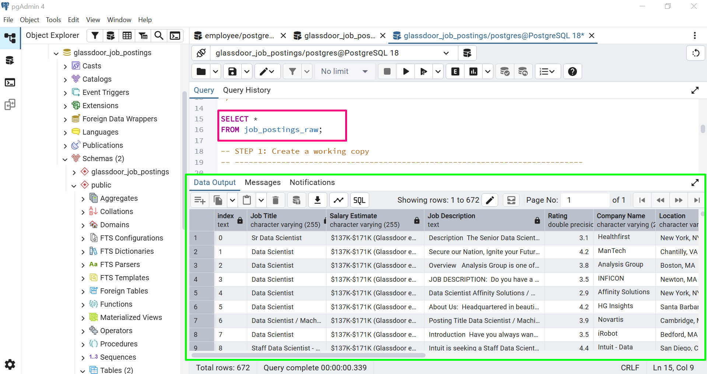
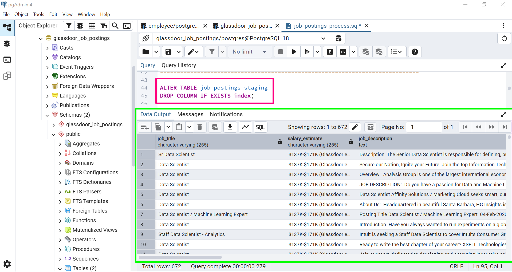
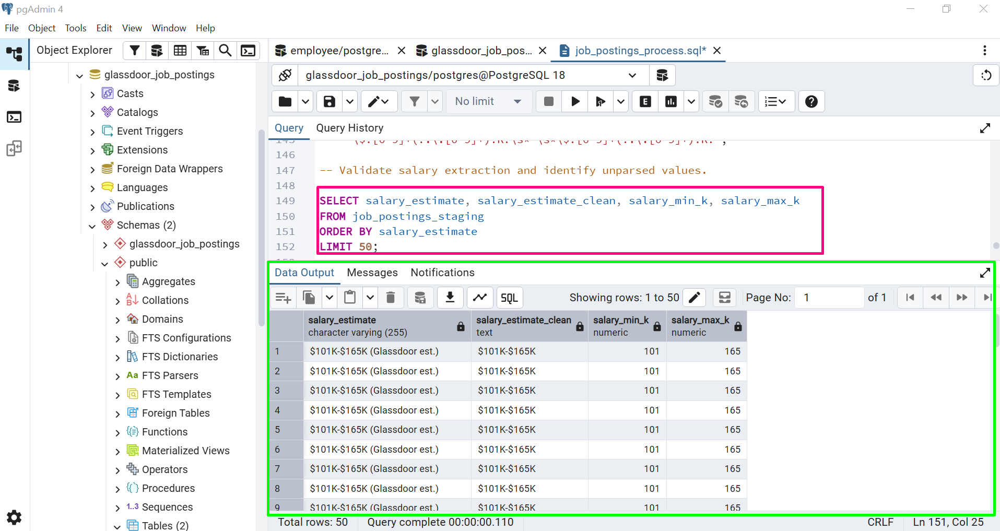
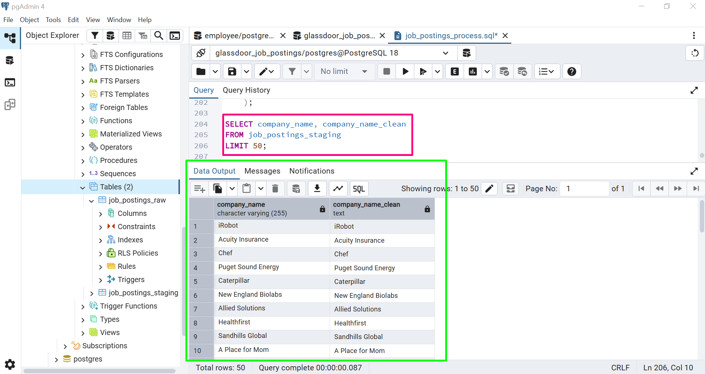
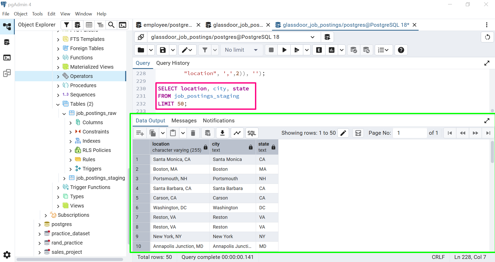
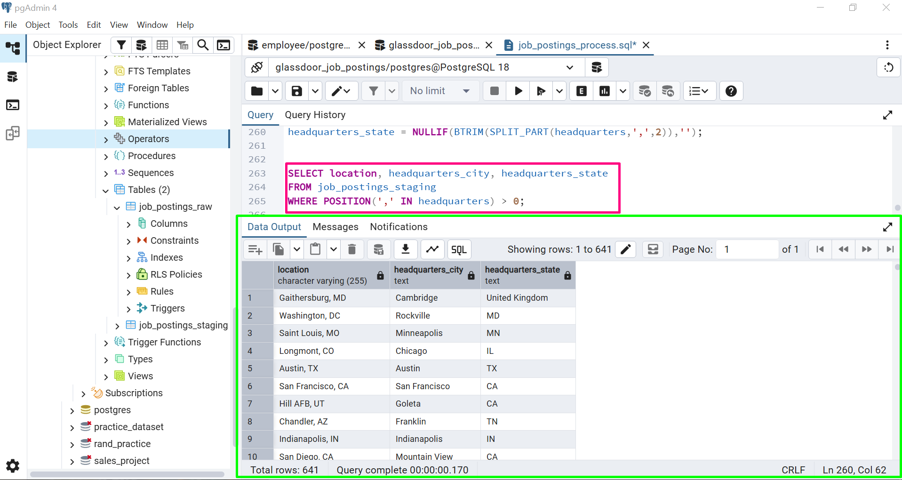
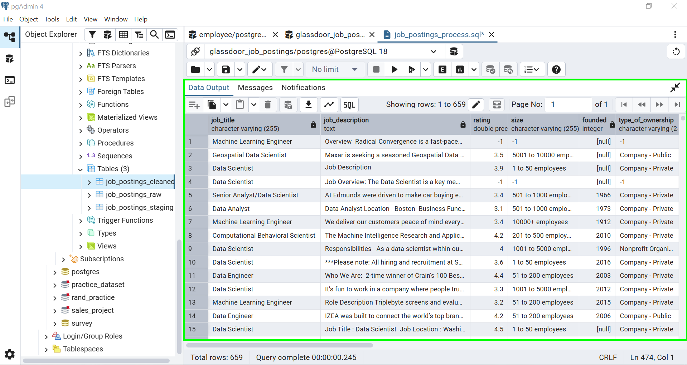

# Data Cleaning Log

## Project: Glassdoor Data Science Job Postings

- **Database:** PostgreSQL
- **Dataset:** [Data Science Job Posting on Glassdoor. Kaggle](https://www.kaggle.com/datasets/rashikrahmanpritom/data-science-job-posting-on-glassdoor)
- **Main SQL:** `04_job_postings_staging.sql`

## Overview

This log documents the main cleaning steps performed on the Glassdoor job postings dataset using PostgreSQL. It describes the issues found, the changes made, and the queries used to check the results.

The original raw table was kept unchanged. All cleaning operations were performed on a separate staging table.

## 1. Initial Data Inspection

**Problem:** The dataset needed to be checked before cleaning.

**What I did:**
- Reviewed the table structure and column names.
- Checked sample records and data formats.
- Recorded the initial row count.

**SQL used:** `SELECT`, `COUNT()`

**Screenshot:**

## 2. Removing Unnecessary Columns

**Problem:** The imported dataset contained an extra index column that was not needed.

**What I did:** Removed the index column from the staging table.

**SQL used:** `ALTER TABLE`, `DROP COLUMN`

**Screenshot:**

## 3. Standardizing Column Names

**Problem:** Some column names contained spaces and inconsistent capitalization.

**What I did:** Renamed the columns using lowercase letters and underscores, such as `Job Title` to `job_title`.

**SQL used:** `ALTER TABLE`, `RENAME COLUMN`

**Screenshot:**

## 4. Cleaning Salary Estimates

**Problem:** Salary estimates contained currency symbols, `K` suffixes, salary ranges, and additional text in parentheses.

**What I did:**
- Reviewed the original salary formats.
- Removed trailing text in parentheses.
- Extracted minimum and maximum salary values into separate numeric columns when the format matched the expected pattern.
- Kept the original salary estimates for comparison.

**SQL used:** `BTRIM()`, `REGEXP_REPLACE()`, `REGEXP_MATCH()`, `NUMERIC`

**Screenshot:**

**Validation:** Compared the original salary estimates with the extracted values and checked records that could not be parsed.

## 5. Cleaning Company Names and Job Titles

**Problem:** Some company names contained trailing rating values, and job titles needed consistent formatting.

**What I did:**
- Removed recognizable trailing rating patterns from company names in a separate column.
- Trimmed extra spaces.
- Standardized job title capitalization.

**SQL used:** `REGEXP_REPLACE()`, `BTRIM()`, `INITCAP()`

**Screenshot:**

## 6. Separating Location Fields

**Problem:** Job locations and company headquarters were stored in combined text fields.

**What I did:**
- Created separate columns for job location city and state.
- Created separate columns for headquarters city and state.
- Split the values using commas and removed extra spaces.
- Reviewed values that did not match the expected format.
- Converted `-1` in `headquarters_city` to `NULL`.

**SQL used:** `SPLIT_PART()`, `BTRIM()`, `POSITION()`, `UPDATE`

**Screenshots:**

**Validation:** Reviewed location values that could not be split using the expected format.

## 7. Handling Missing and Unknown Values

**Problem:** Some fields contained empty strings or values representing unknown information.

**What I did:**
- Converted empty strings to `NULL` in selected columns.
- Converted `-1` in the `Founded` column to `NULL`.
- Checked missing values in important fields.

**SQL used:** `UPDATE`, `NULLIF()`, `BTRIM()`, `IS NULL`, `COUNT() FILTER`

## 8. Identifying and Removing Duplicates

**Problem:** Duplicate records can affect row counts and analysis.

**What I did:**
- Used `ROW_NUMBER()` to identify records matching the selected duplicate criteria.
- Reviewed the matching records.
- Removed extra records while keeping one record from each duplicate group.

**SQL used:** CTEs, `ROW_NUMBER()`, `DELETE ... USING`

**Validation:** Checked the final row count and reviewed duplicate records using the same criteria.

## 9. Final Data Validation

After cleaning the data, I ran queries to check the results.

The checks included:

- Final row count.
- Missing company names and location fields.
- Salary values that could not be extracted.
- Salary ranges where the minimum exceeded the maximum.
- Remaining `-1` values in the `Founded` column.
- Extracted location fields and the final table contents.

**Screenshot:**

**Results:** Actual row counts and validation results should be recorded after running the SQL scripts.

## 10. Final Table

Created `job_postings_cleaned` from the staging table after the cleaning steps.

The final table excludes the original `company_name`, `salary_estimate`, `headquarters`, and `location` columns. The cleaned or extracted columns are intended to provide the corresponding values for further analysis.

## Summary

This project gave me practical experience cleaning job posting data with PostgreSQL. I worked on column standardization, salary extraction, company name cleaning, location splitting, missing values, duplicate removal, and data validation.

The SQL scripts and screenshots document the steps taken throughout the project.

## Dataset Source

[Data Science Job Posting on Glassdoor. Kaggle](https://www.kaggle.com/datasets/rashikrahmanpritom/data-science-job-posting-on-glassdoor)