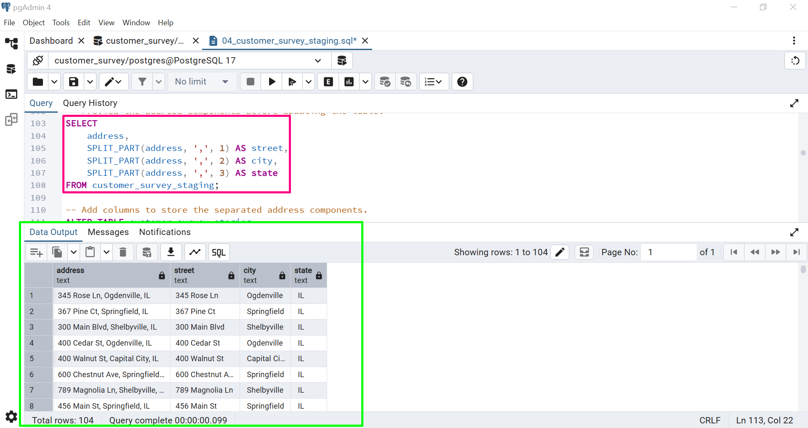
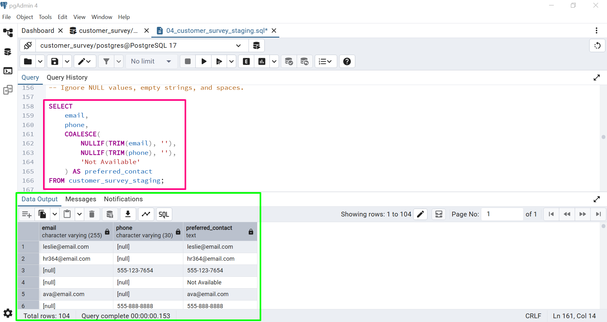
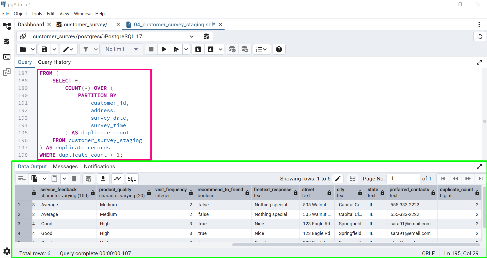

# Data Cleaning Log

## Project: Customer Survey Data Cleaning

- **Database:** PostgreSQL
- **Source Table:** `customer_survey_raw`
- **Working Table:** `customer_survey_staging`
- **Main SQL File:** `04_customer_survey_staging.sql`

## Overview

This project focuses on cleaning a customer survey dataset using PostgreSQL. The work includes standardizing text, converting survey dates, separating address fields, cleaning contact information, and checking for duplicate records.

The raw table remains unchanged. All cleaning work is carried out in the staging table.

## 1. Initial Data Inspection

The first step was to review the imported data and identify fields that needed attention.

**What I did:**
- Checked the table structure and column names.
- Reviewed sample records.
- Counted the initial number of rows.
- Checked distinct customer IDs and survey records.

**SQL used:** `SELECT`, `COUNT()`, `COUNT(DISTINCT)`

## 2. Text Cleaning and Standardization

Some text values contained extra spaces or inconsistent formatting.

**What I did:**
- Removed leading and trailing spaces.
- Standardized values in `rewards_member`.
- Reviewed inconsistent values in `service_feedback`.
- Compared distinct values before and after cleaning.

**SQL used:** `BTRIM()`, `UPDATE`, `CASE`

## 3. Survey Date Cleaning and Standardization

The `survey_date` column needed to use the PostgreSQL `DATE` data type.

**What I did:**
- Reviewed the existing date values.
- Checked for invalid or inconsistent formats.
- Converted valid values to `DATE`.
- Checked the converted values.

**SQL used:** Date conversion functions, `ALTER TABLE`, `USING`, as applicable to the implemented query.

## 4. Address Separation

The `address` column contained street, city, and state information in a single field.

**What I did:**
- Reviewed the address format.
- Separated the values into `street`, `city`, and `state` where possible.
- Removed extra spaces from the extracted values.
- Checked addresses that did not follow the expected format.

**SQL used:** `SPLIT_PART()`, `BTRIM()`, `UPDATE`

**Screenshot:**

## 5. Email and Phone Cleaning

The contact fields needed to be checked for extra spaces, missing values, and inconsistent formatting.

**What I did:**
- Cleaned email and phone values.
- Reviewed missing contact information.
- Created a `preferred_contact` column using the available contact details and the selected rules.
- Checked the results for records with missing email or phone values.

**SQL used:** `BTRIM()`, `NULLIF()`, `CASE`, `UPDATE`

**Screenshot:**

## 6. Duplicate Record Checks

Repeated customer IDs do not always mean duplicate survey records, so the matching records needed to be reviewed.

**What I did:**
- Checked for repeated customer IDs.
- Compared records using the selected survey fields.
- Identified potential duplicates.
- Reviewed matching records before removing any entries.

**SQL used:** `GROUP BY`, `COUNT()`, `ROW_NUMBER()`, CTEs, where applicable.

**Screenshot:**

## 7. Final Data Validation

After the cleaning steps, I checked the staging table to review the results.

**Checks included:**
- Initial and final row counts.
- Missing values in important columns.
- Standardized membership and feedback values.
- Survey date data type and values.
- Separated address fields.
- Cleaned email and phone values.
- Potential duplicate records remaining.

**SQL used:** `COUNT()`, `COUNT(*) FILTER`, `IS NULL`, `GROUP BY`, `DISTINCT`

**Results:** Add the actual row counts and validation findings after running the queries.

## 8. Final Table

The cleaned data can be stored in a separate `customer_survey_cleaned` table for further analysis. The final table should contain the fields needed for reporting and analysis.

The original `customer_survey_raw` table is retained for reference.

## Data Source

The dataset was obtained from [Data Analytics Lab](https://github.com/data-analytics-labs/tutorials/blob/main/survey_dataset_messy_txt.txt).
